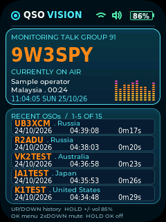
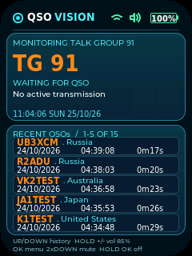
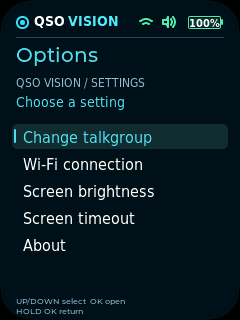
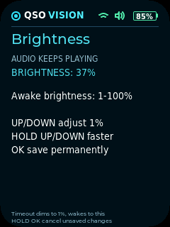
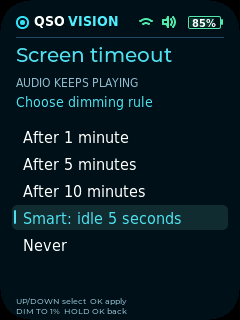
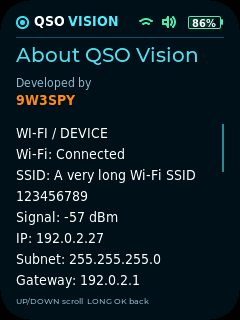

**简体中文** · [English](README.md)

# QSO VISION for AI Passport

**随身、仅接收的 BrandMeister 通话组监听器。**
开发者：**limesoft (9W3SPY)**，当前应用构建：**2.3**。

通过 Wi-Fi 收听可用的实时 DMR 通话组，查看当前电台资料，并用实体按键浏览通联历史。
本应用直接运行于 AI Passport，操作及配网无需 Android APK 或外部手机。

[下载 2.3](https://github.com/lim3soft/QSO-Vision-for-Ai-Passport/releases/tag/v2.3) · [使用指南](docs/USER_GUIDE.zh_CN.md) ·
[构建/安装](docs/BUILD.zh_CN.md) · [更新日志](docs/CHANGELOG.zh_CN.md) ·
[网页版](https://qso.nightfall.monster) · [作者主页](https://github.com/lim3soft)

## 界面截图

以下为使用**示例资料**的原生界面渲染，并非设备照片或实机实时截屏。
作者已反馈最终 2.3 版本在设备上正常运行。

| 当前通话：呼号、时钟、活动 EQ | 空闲：时钟及归零的活动条 |
| --- | --- |
|  |  |
| 选项 | 保存的屏幕亮度 |
|  |  |
| 屏幕超时 | 关于 / 网络状态 |
|  |  |

## 功能

- 预设 **91、45401、46001、46020、50210**，支持按键输入自定义组号。
- Hoseline 实时音频，调暗或关屏时继续后台播放。
- 显示可用的呼号、姓名、国家及通话时长，最多保存 **15 条历史，每屏五条**，逐条滚动。
- 当前时钟格式 **hh:mm:ss DAY dd/mm/yy**，网络对时，默认马来西亚 UTC+08:00。
  右下角 EQ 随 QSO 活动跳动，空闲时归零；它是活动动画，不是实测频谱。
- 设备端 Wi-Fi 扫描/密码键盘、配置保存及失败重连。
- 保存的唤醒亮度 **1–100%**；超时选项为 **1 / 5 / 10 分钟、Smart、Never**。
  默认 Smart 空闲五秒后调暗至 **1%**，恢复时使用保存亮度。
- 电量百分比、静音/连接图标及可滚动的 About 状态页。

## 快速开始与按键

1. 将完整固件刷写至 **0x0** 后重启，完整刷写可能重置设置，详见[安装说明](docs/BUILD.zh_CN.md)。
2. 短按 **OK → Options → Wi-Fi connection**，选中可联网的 2.4GHz 网络。
   UP/DOWN 选密码字符（长按快滚），OK 添加，双按 UP 删除，**双按 OK 连接**。
   最多 25 字符；成功保存并回主页，失败时长按 OK 返回列表重试。
3. 短按 **OK → Change talkgroup** 选预设组。Custom 中 UP/DOWN 选数字、OK 添加、
   双按 UP 删除、双按 OK 应用。

| 监听主页按键 | 功能 |
| --- | --- |
| 短按 UP / DOWN | 每次向较新 / 较旧历史滚动一条 |
| 长按 UP / DOWN | 连续增大 / 减小音量 |
| 双按 DOWN | 静音 / 恢复 |
| 短按 OK | 选项菜单 |
| 长按 OK | 渐暗关屏 / 以保存亮度唤醒，音频继续 |
| 菜单内 UP/DOWN、OK、长按 OK | 选择、确认、返回 |

手动关屏后只有**长按 OK** 唤醒。亮度及超时设置在 Options 内。
详见[中文指南](docs/USER_GUIDE.zh_CN.md)或[中英 TXT 指南](firmware/2.3/User-Guide-CN-EN.txt)。

## 版本与原始固件

| 版本 | 下载 | 源码情况 |
| --- | --- | --- |
| **2.3 — 当前版** | [版本页](https://github.com/lim3soft/QSO-Vision-for-Ai-Passport/releases/tag/v2.3) · [BIN](https://github.com/lim3soft/QSO-Vision-for-Ai-Passport/releases/download/v2.3/QSO-Vision.bin) | 此仓库/标签含完整当前源码 |
| 2.0 — 历史版 | [版本页](https://github.com/lim3soft/QSO-Vision-for-Ai-Passport/releases/tag/v2.0) · [BIN](https://github.com/lim3soft/QSO-Vision-for-Ai-Passport/releases/download/v2.0/QSO-Vision.bin) | 原已发布镜像与指南，仅归档标签 |
| 1.0 — 历史版 | [版本页](https://github.com/lim3soft/QSO-Vision-for-Ai-Passport/releases/tag/v1.0) · [BIN](https://github.com/lim3soft/QSO-Vision-for-Ai-Passport/releases/download/v1.0/QSO-Vision.bin) | 最后保留的 1.0 标记镜像，仅归档标签 |

每个版本附清单及 SHA-256 校验值，并按作者要求在 `firmware/<版本>/` 保存 `.bin`。
未保留匹配的旧源码，因此 1.0/2.0 标签**不冒充原始源码快照**；当前使用及完整可构建源码请选 2.3。

2.3 完整镜像 **1,767,264 字节**，SHA-256：
`d0f9f46e335af35d4f336ab8afc3b0d29f8a95ca2562de760f430b2324475824`。
新增发布文档和脚本不会改变保留的作者实测固件；重新构建会因时间戳等原因改变校验值。

## 构建、测试与限制

目标为 **FoloToy AI Passport、ESP32-C3、8 MB 闪存、无 PSRAM**，使用 **ESP-IDF 5.5.3**。
激活 IDF 后运行 `./tools/validate.sh --firmware`，应用主机测试运行 `./tools/test_qso.sh`。
详见[构建说明](docs/BUILD.zh_CN.md)、[架构](docs/brandmeister-monitor.zh_CN.md)及
[验证记录](docs/VALIDATION.zh_CN.md)。

原构建/布局/归档、应用专用主机及 UI 测试通过，作者反馈实机正常；未进行全部路由器、
声学、长期或续航测量。完整上游模板检查仍失败于原演示 `on_key` 契约，该检查保留且不宣称通过，
应用 CI 单独运行适用测试。

音频及呼号/历史依赖外部服务，可能不可用、延迟或不完整。自定义组号用按键输入，本版不含语音识别。
设备界面为英文、文档双语；没有可靠充电信号时不启用充电动画。应用**仅接收，不提供 DMR 发射功能**。

## 署名与许可

应用：**limesoft (9W3SPY)**；硬件支持/模板：
[FoloToy/ai-passport](https://github.com/FoloToy/ai-passport)，基线提交 `006c227`。
保留原 [MIT 许可](LICENSE)、[字体许可](assets/fonts/DejaVu-LICENSE.txt)与 [NOTICE](NOTICE)。
ESP-IDF 和组件遵循各自许可。

独立项目，与 BrandMeister、Hoseline、RadioID、FoloToy 无隶属或背书关系，相关服务、数据、
商标仍受各权利人的条款/许可约束。[作者主页](https://github.com/lim3soft) ·
[QSO VISION 网页版](https://qso.nightfall.monster)。
